# Parachord for Android and iOS

A unified music player that brings Spotify, Apple Music, SoundCloud, Bandcamp, Amazon Music, your own Subsonic or Navidrome server, and your local files into one queue. Parachord finds every track on each of your services and plays it from the best match, in the order you rank them.

This repo holds both mobile companions to the [Parachord desktop app](https://github.com/Parachord/parachord): a native **Android** app (Jetpack Compose) and a native **iOS** app (SwiftUI). They share one Kotlin Multiplatform core. Both apps use the same resolver pipeline, plugin system and playlist sync as desktop, and the Android app is very close to feature parity.

## Install

Both apps are public betas that anyone can join. The same links are on [parachord.com](https://parachord.com/#mobile).

### Android (Android 8.0+)
- **Google Play**: join the [Parachord-Testers group](https://groups.google.com/g/parachord-testers) and opt in to testing, then install from the [Play listing](https://play.google.com/store/apps/details?id=com.parachord.android). Updates arrive through the Play Store.
- **Sideload**: get the signed APK from the [latest release](https://github.com/Parachord/parachord-mobile/releases/latest) and install it directly. You need to give your browser or Files app the "Install unknown apps" permission. Every build is on the [releases page](https://github.com/Parachord/parachord-mobile/releases).

### iOS (iOS 17+)
- **TestFlight**: join the [public beta](https://testflight.apple.com/join/zXvg5zxK).

## Screenshots

These are from the Android app; the iOS app follows the same layout with native SwiftUI styling.

<table>
  <tr>
    <td align="center" valign="top" width="33%">
      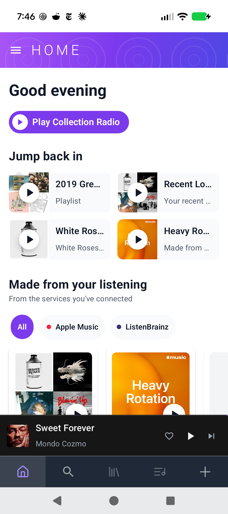<br>
      <sub><b>Home</b> — jump back in, your mixes and playlists, picks for you</sub>
    </td>
    <td align="center" valign="top" width="33%">
      <br>
      <sub><b>Sidebar</b> — friends with live listening status</sub>
    </td>
    <td align="center" valign="top" width="33%">
      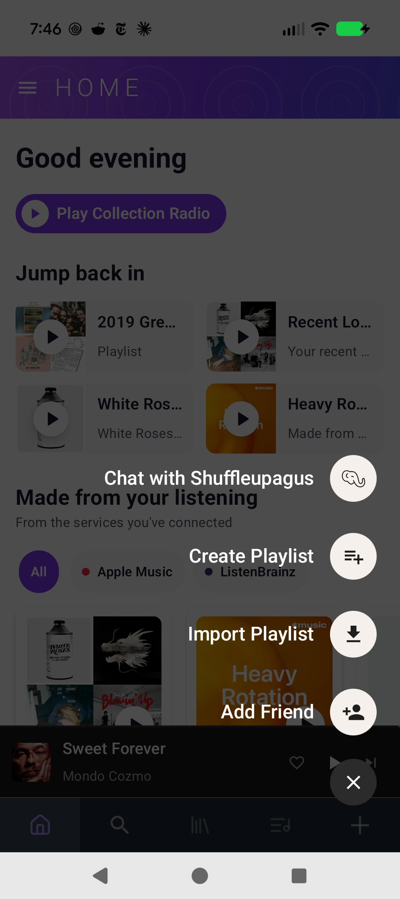<br>
      <sub><b>Quick actions</b> — DJ chat, create/import playlist, add friend</sub>
    </td>
  </tr>
  <tr>
    <td align="center" valign="top" width="33%">
      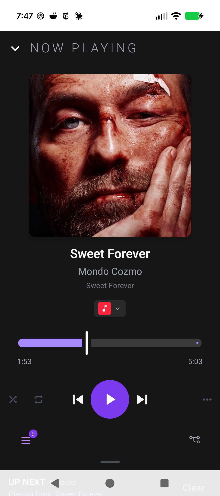<br>
      <sub><b>Now Playing</b> — resolver chip shows active source</sub>
    </td>
    <td align="center" valign="top" width="33%">
      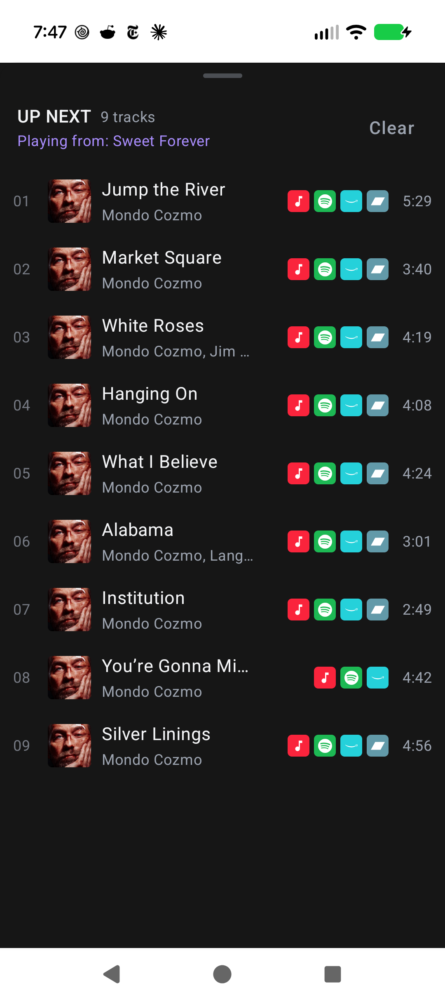<br>
      <sub><b>Queue</b> — mixed Spotify + Apple Music rows</sub>
    </td>
    <td align="center" valign="top" width="33%">
      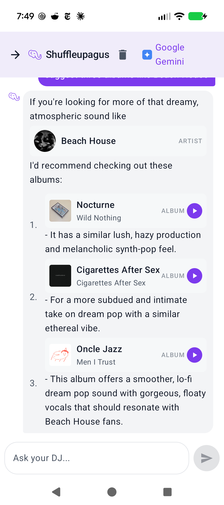<br>
      <sub><b>Shuffleupagus</b> — natural-language DJ (ChatGPT / Claude / Gemini)</sub>
    </td>
  </tr>
  <tr>
    <td align="center" valign="top" width="33%">
      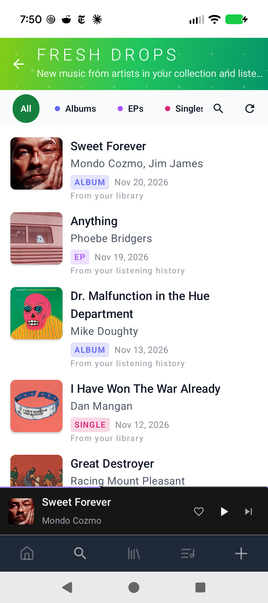<br>
      <sub><b>Fresh Drops</b> — new releases from artists you follow</sub>
    </td>
    <td align="center" valign="top" width="33%">
      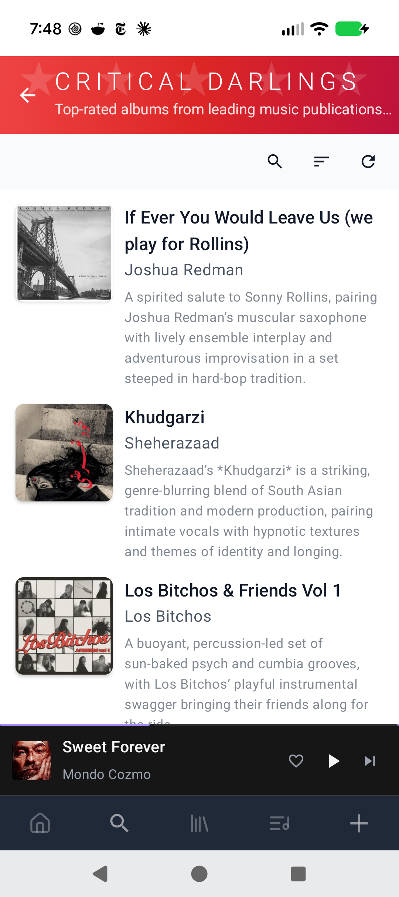<br>
      <sub><b>Critical Darlings</b> — top-rated albums with AI blurbs</sub>
    </td>
    <td align="center" valign="top" width="33%">
      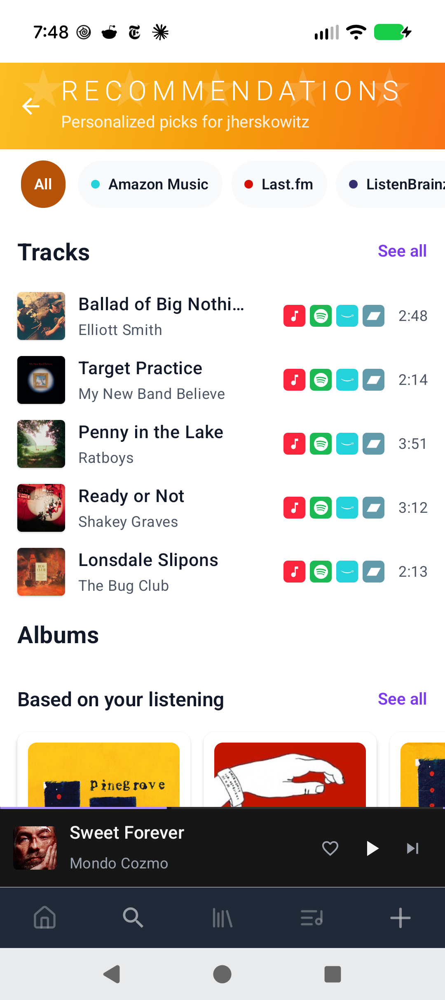<br>
      <sub><b>Recommendations</b> — ListenBrainz, Last.fm + Apple Music blended feed</sub>
    </td>
  </tr>
  <tr>
    <td align="center" valign="top" width="33%">
      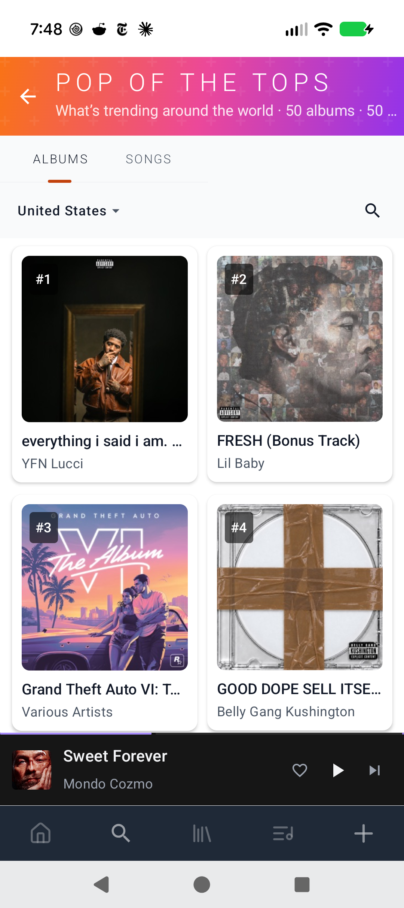<br>
      <sub><b>Pop of the Tops</b> — global charts</sub>
    </td>
    <td align="center" valign="top" width="33%">
      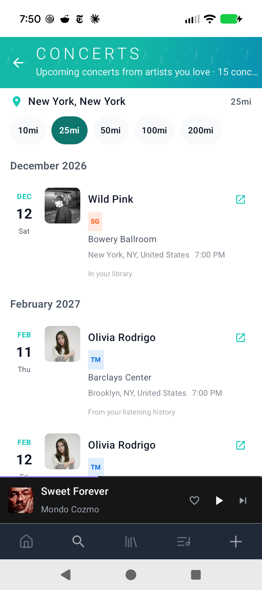<br>
      <sub><b>Concerts</b> — Ticketmaster + SeatGeek, library-aware</sub>
    </td>
    <td align="center" valign="top" width="33%">
      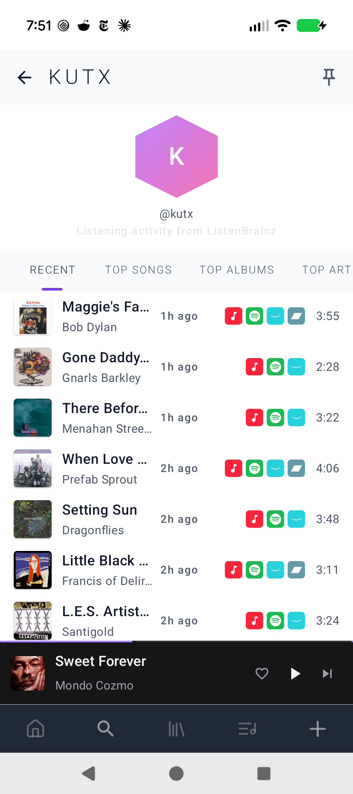<br>
      <sub><b>Friends</b> — their Last.fm top albums at a glance</sub>
    </td>
  </tr>
  <tr>
    <td align="center" valign="top" width="33%">
      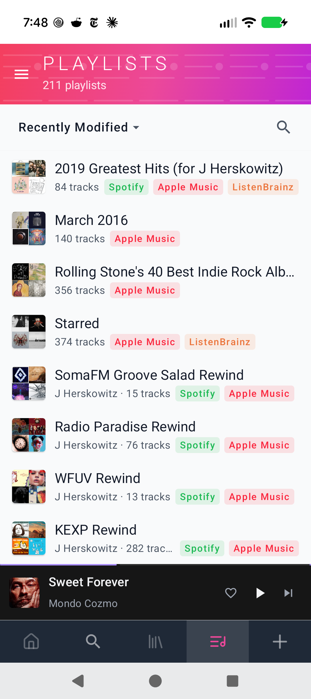<br>
      <sub><b>Playlists</b> — hosted XSPF + Spotify-synced side by side</sub>
    </td>
    <td align="center" valign="top" width="33%">
      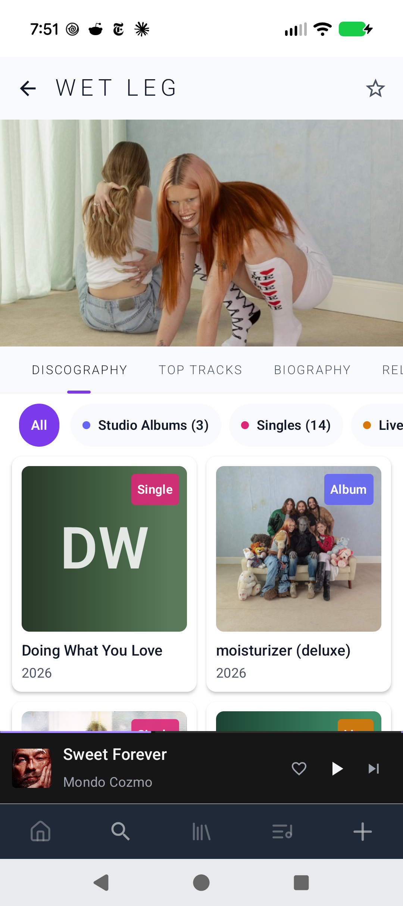<br>
      <sub><b>Artist</b> — discography with release-type filter</sub>
    </td>
    <td align="center" valign="top" width="33%">
      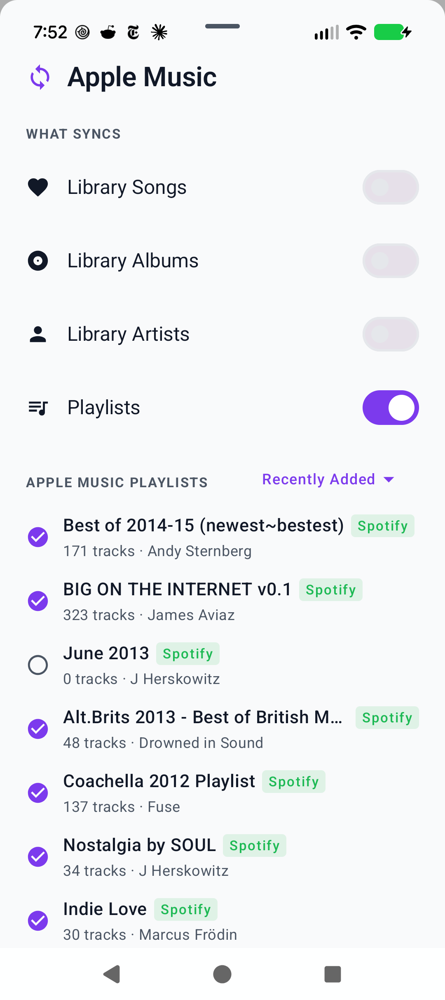<br>
      <sub><b>Sync wizard</b> — pick what to pull from Spotify</sub>
    </td>
  </tr>
</table>

## Features

### Unified playback
One queue across all sources. Tap any track and Parachord figures out where to play it from.

| Source | Android | iOS |
|--------|---------|-----|
| **Spotify** (Premium) | Spotify Connect via the Web API: controls Spotify on your phone or any Connect device | Same: Spotify Connect via the Web API |
| **Apple Music** (subscription) | MusicKit JS in a hidden WebView | Native MusicKit |
| **SoundCloud** | SoundCloud's own player in a hidden WebView | Same, in a hidden WKWebView |
| **Local files** | Device media library, with artwork extraction and online enrichment | Device music library |
| **Bandcamp** | Bandcamp's own player in a hidden WebView | Same, in a hidden WKWebView |
| **Subsonic / Navidrome** (your own server) | ExoPlayer, from a stream URL the plug-in builds at play time | AVPlayer, the same way |
| **Amazon Music** | ExoPlayer with Widevine, from the plug-in's manifest and licence; purchases fall back to a plain stream | FairPlay HLS through AVFoundation; purchases fall back to a plain stream |
| **Direct HTTP streams** | ExoPlayer | AVPlayer |

**Playback quality (Android).** Settings → General → Playback Quality sets the tier, adaptive streaming and "Prefer Dolby Atmos mixes" for the services that follow it (Amazon Music, and Apple Music's bitrate). Atmos is offered only when the phone, or the output it's connected to, can play it. Now Playing shows a Lossless or Dolby Atmos badge, and the car is told when a track is in Atmos. Each plug-in's settings say who sets its quality (for example "Set in the Spotify app").

### Resolver pipeline
Sources are scored priority first, confidence second. A Spotify result at 70% confidence beats SoundCloud at 95% when Spotify is ranked higher. Matches below 60% confidence are dropped, so a wrong song never plays. An exact ISRC or MusicBrainz recording match scores 100%, even when the names differ.

Default order: `spotify > applemusic > bandcamp > soundcloud > localfiles > subsonic > youtube`. You can change it in Settings, and a plug-in you turn off and on again goes back where you ranked it.

### Playlist and library sync
- **Spotify, Apple Music and ListenBrainz.** Import playlists, saved tracks, albums and followed artists, and push locally created playlists to any of them. A playlist pulled from one service can mirror to the others.
- **Hosted XSPF.** Import any `.xspf` URL, such as a radio station's "recently played" feed. Parachord polls it every 5 minutes and keeps the local copy and its mirrors in step.
- **Three-layer dedup** prevents duplicate remote playlists on re-sync. Track removals are remembered, so a removed track isn't re-imported by the next pull. A song you saved on one service and synced from another stays one row in your collection.
- **Sync never shrinks a playlist by accident.** A playlist is pushed back to the service it came from only when you edited it here. A mirror isn't rewritten while some of its tracks haven't been looked up on that service yet (offline, rate-limited); it waits for the next sync. Deleting a playlist removes it only from the services you tick.
- **New sync engine (preview).** An opt-in sync engine merges edits made on any service. Before you switch, it shows a dry-run preview of exactly what would change.
- **Remove duplicates.** When a playlist holds the same song more than once, its page shows a banner that removes the later copies (keeping the first of each) after you confirm. Synced copies on other services get the cleaned list on the next sync.

Apple Music's API can't delete or rename playlists or remove tracks from them, so those changes have to be made in the Apple Music app.

### Discovery
- **Recommendations** (Android and iOS): personalized Tracks, Albums, Artists, Playlists and Listeners (people with a similar taste) from Last.fm, ListenBrainz and Apple Music (any plugin that offers recommendations), blended with Shuffleupagus's AI picks from your own ChatGPT, Claude or Gemini key, with a filter for each source.
- **Fresh Drops** and **Critical Darlings**: curated new releases.
- **Pop of the Tops**: chart albums and songs by country, with songs from Apple Music or Last.fm (including a global Last.fm chart).
- **Home** (Android and iOS, from one shared model): desktop's Home. Jump back in, mixes made from your listening (ListenBrainz's Daily and Weekly Jams, Apple Music's Heavy Rotation and Replay), your playlists freshest first, albums you might love, Fresh Drops and Critical Darlings, concerts near you and Ask Shuffleupagus. A new profile gets a three-step getting-started layout instead.
- **Weekly Jams** and **Weekly Exploration**: this week's playlists from ListenBrainz. Weekly Jams is one of Home's mixes; Weekly Exploration is in Recommendations' Playlists row. Saving one keeps that week's copy under its date.
- **On Tour**: a teal dot next to the artist name when they're playing near you. The radius is configurable.
- **Friends**: see what your Last.fm and ListenBrainz contacts have been playing, and **Listen Along** with them.
- **Spinoff**: start a radio of similar tracks from whatever is playing, without touching your queue. When Last.fm has few similar tracks for a song, the radio fills up with the top songs of similar artists.
- **Android Auto and CarPlay**: browse your playlists, loved songs and Collection Radio from the car, with Now Playing buttons for the heart and Spinoff and (CarPlay) Up Next. Both draw one shared browse tree. After three tracks in a row that can't play, playback stops and asks you to open Parachord on the phone, instead of running silently to the end of the queue.
- **Concerts**: Ticketmaster and SeatGeek search, filtered by location.

### AI features (bring your own key)
- **DJ chat (Shuffleupagus)**: natural-language control, such as "play something like Beach House but more upbeat", "queue the new Waxahatchee album" or "skip to Sugar".
- **Album and artist recommendations** grounded in your actual listening history.
- **Providers**: ChatGPT, Claude and Gemini. Ollama works as an `.axe` plugin on desktop but is disabled on mobile, because it needs a local server.

### Scrobbling
- **ListenBrainz**, **Last.fm** and **Libre.fm**, plus optional pushing of loved tracks to ListenBrainz and Last.fm.
- **MBID enrichment.** Tracks get MusicBrainz identifiers in the background from ListenBrainz's MBID Mapper. If the mapper is down, the lookup falls back to ListenBrainz's acr-lookup service, or to MusicBrainz by ISRC. Scrobbles include `recording_mbid`, `artist_mbids` and `release_mbid`.

### Sharing
- **Tracks, albums and artists** share as [Achordion](https://achordion.xyz) links. Recipients get a rich preview with per-service listen buttons (Spotify, Apple Music, SoundCloud), whatever platform they're on.
- **Playlists** share as Achordion playlist links through their ListenBrainz copy, so a playlist has to be synced to ListenBrainz first. ListenBrainz copies are private; if the one you share is, Parachord asks whether to make it public, and shares nothing if you say no.
- **iOS share extension**: send a Spotify or Apple Music link to Parachord from any app.

### .axe plugin system
Both apps run the same plugins as desktop. Most are bundled as `.axe` files, and all are updated at runtime from the [`parachord-plugins`](https://github.com/Parachord/parachord-plugins) marketplace, checked at most once a day. Android hosts them in a headless WebView and iOS in JavaScriptCore, and both run desktop's `resolver-loader.js` unchanged. A plugin can name the oldest app version it works with, and a plugin that needs something the app doesn't provide isn't loaded.

Plugin types: content resolvers, AI providers, meta-services (Last.fm, MusicBrainz, Discogs, Wikipedia), scrobblers and concert services. YouTube and Ollama are filtered out on mobile (`capabilities.mobile: false`). Native resolvers (Spotify, Apple Music, plus local files on Android) take priority over their `.axe` equivalents for speed. SoundCloud and Bandcamp resolve through their plugins on both apps. A plugin that declares `capabilities.html5Stream` (Subsonic: your own Navidrome/Subsonic server) streams through the host player (ExoPlayer on Android, AVPlayer on iOS), with the plugin building the stream URL at play time; its settings fields render in Settings with a Test connection button. Amazon Music signs in through a web session the app hosts. It plays its catalog through Widevine on Android and FairPlay on iOS, and plays your purchases from a plain stream when those don't start.

Each music plug-in's settings have one **Enable** switch. While it's on, there are separate switches for **Play from**, **Use metadata from** and **Use recommendations from** that plug-in. A plug-in that reports its own account (Amazon Music) shows the account there, with Sign in and Sign out. A plan that can't play, or plays only your purchases, is shown on the plug-in's tile in the priority list.

### Background resilience (Android)
External playback (Apple Music, Spotify Connect) survives screen-off, Doze mode and Android's foreground-service killer. A silent 1-second WAV loops on ExoPlayer, which keeps `MediaSessionService` happy while the DRM audio flows through MusicKit or Spotify. See [CLAUDE.md](CLAUDE.md), "External Playback Background Survival", for the rationale.

## Subscriptions and copy protection

Parachord is a player for people who already subscribe to the services it plays from, plus their own files and servers. It brings those services together in one app. It is not a way to get music without paying for it, or to keep copies of it.

- **Your account, the service's own streams.** Each service plays through your own account, using that service's own player, its official API, or the same endpoints its own web player uses. Either way, the stream, its license and its quality come from the service. On the subscription services (Spotify, Apple Music, and any other subscription service a resolver plays from), your plays are reported to the service the way its own player reports them, so they count. Where a service needs a subscription for full tracks, so does Parachord.
- **No ripping.** Parachord doesn't decrypt, record, download or save protected streams. It doesn't extract decryption keys, and it doesn't unlock tiers or content your subscription doesn't include.
- **Decryption stays with the service.** On Android and iOS, Spotify plays in Spotify's own app through Spotify Connect. Apple Music on iOS plays through Apple's MusicKit. Apple Music on Android plays through Apple's MusicKit JS player and is decrypted inside Google's Widevine module, using a license Apple issues to your account. A plug-in that supplies a DRM stream (Amazon Music) plays the same way: the plug-in fetches the service's manifest and licence for your account, and Google's Widevine module (Android) or Apple's FairPlay (iOS) decrypts it. Parachord never sees the decryption keys and never saves the audio.
- **Plug-ins follow the same rules.** A plug-in that tries to get around a service's protections isn't accepted into the Parachord marketplace, and is removed if one slips through (see the [plug-in guidelines](https://github.com/Parachord/parachord-plugins#guidelines)). Plug-ins installed from anywhere else aren't reviewed, so Parachord can't vouch for them.

If you work for a music service and have a concern about how Parachord plays your catalog, please [open an issue](https://github.com/Parachord/parachord-mobile/issues).

## Requirements

| | Android | iOS |
|---|---|---|
| OS | Android 8.0+ (API 26) | iOS 17.0+ (iPhone and iPad) |
| Spotify playback | Spotify Premium (the free tier can browse but can't be controlled through the Web API) | Same |
| Apple Music playback | Apple Music subscription | Same |
| AI features | Your own ChatGPT / Claude / Gemini key, set in Settings | Same |

## Setup (development)

### Android

**Prerequisites:** Android Studio Ladybug (2024.2) or newer, JDK 17, Android SDK 35.

Copy the example config and fill in your keys:

```bash
cp local.properties.example local.properties
```

| Key | Required | Get it from |
|-----|----------|-------------|
| `LASTFM_API_KEY` | Yes | https://www.last.fm/api/account/create |
| `LASTFM_SHARED_SECRET` | Yes | Same as above |
| `SPOTIFY_CLIENT_ID` | Yes | https://developer.spotify.com/dashboard |
| `SOUNDCLOUD_CLIENT_ID` | Optional | https://soundcloud.com/you/apps |
| `SOUNDCLOUD_CLIENT_SECRET` | Optional | Same as above |
| `APPLE_MUSIC_AUTHKEY_P8` | Optional | Path to your MusicKit AuthKey. The build mints the developer token and rotates it before it expires. |
| `APPLE_MUSIC_DEVELOPER_TOKEN` | Optional | Generated from the AuthKey above, or set by hand (`scripts/apple-music-token.py`) |
| `ACHORDION_BEARER_TOKEN` | Optional | Pre-warms Achordion's track-links cache on share and scrobble. Blank turns the submit off. |

AI provider keys (ChatGPT / Claude / Gemini) are entered per user in Settings, not at build time, which keeps them out of the open-source build config. Concert-service keys are also entered in Settings; optionally, `TICKETMASTER_API_KEY` and `SEATGEEK_CLIENT_ID` in `local.properties` supply fallback keys for users who haven't added their own.

```bash
# Build + install debug APK on connected device
./gradlew installDebug

# Force-stop the old process so Android picks up the new code
adb shell am force-stop com.parachord.android.debug

# Run unit tests (shared module + app)
./gradlew :shared:testDebugUnitTest :app:testDebugUnitTest
```

Release builds require a keystore; the CI workflow handles signing and publishing. See [docs/play-store-publishing.md](docs/play-store-publishing.md).

#### Keeping your data between builds

- **The debug build is its own app.** It installs as `com.parachord.android.debug`, next to the release `com.parachord.android`, with its own data. Development never touches a release install.
- **`installDebug` keeps the app's data** (collection, playlists, settings, sign-ins). You lose it only in two cases:
  - you uninstall the app;
  - the signing key changes. Debug builds are signed with your machine's `~/.android/debug.keystore`, and Android refuses an update signed with another key, so you'd have to uninstall. If you build on more than one machine, copy the same `debug.keystore` to each.
- **There's no backup.** `allowBackup="false"` keeps sign-in tokens out of cloud backup and `adb backup`. Your playlists and collection come back through sync (Spotify, Apple Music, ListenBrainz) after a fresh install. Settings and sign-ins don't.
- **You can snapshot and restore the debug build's data.** It's debuggable, so `run-as` can read and write its data folder. Force-stop the app first, so the database isn't mid-write:

  ```bash
  adb shell am force-stop com.parachord.android.debug
  # Snapshot
  adb exec-out run-as com.parachord.android.debug tar -cf - . > parachord-debug-data.tar
  # Restore (onto the same install)
  adb exec-in run-as com.parachord.android.debug tar -xf - < parachord-debug-data.tar
  ```

  The snapshot holds the database, preferences and caches. Restored onto the same install, everything comes back, sign-ins included. After an uninstall, sign-ins have to be redone: they're encrypted with an Android Keystore key, which goes away with the app. The file holds your account data, so keep it private.

### iOS

**Prerequisites:** Xcode 26 with the iOS 26 SDK, JDK 17 (Gradle builds the shared framework).

Copy the example secrets and fill in your keys:

```bash
cp iosApp/Parachord/Secrets.xcconfig.example iosApp/Parachord/Secrets.xcconfig
```

`Secrets.xcconfig` holds `LASTFM_API_KEY`, `LASTFM_SHARED_SECRET`, `APPLE_MUSIC_DEVELOPER_TOKEN` and `ACHORDION_BEARER_TOKEN`. It's gitignored, and the project still builds without it; Last.fm features are then inert until you add it. Spotify is bring-your-own: users enter their Spotify client ID in Settings.

Open `iosApp/Parachord.xcodeproj` and run the `Parachord` scheme. A build phase runs `:shared:embedAndSignAppleFrameworkForXcode` on every build, so changes to `shared/` are picked up automatically. To build headless:

```bash
xcodebuild build -project iosApp/Parachord.xcodeproj -scheme Parachord \
  -destination 'platform=iOS Simulator,name=iPhone 17 Pro'
```

Run the shared tests on the iOS simulator with `./gradlew :shared:iosSimulatorArm64Test`. Kotlin/Native catches bugs the JVM suite can't, such as unsupported regex classes. iOS-specific notes are in [iosApp/AGENTS.md](iosApp/AGENTS.md).

### Cutting a release

**Android** is tag-driven:

```bash
./scripts/release-version.sh 0.4.0-beta.3
git push && git push origin v0.4.0-beta.3
```

The `v*` push triggers the release workflow. It signs the APK and AAB, attaches both to a GitHub Release, and uploads the AAB to Play's closed testing track (`alpha`). Prerelease version names (a hyphen in the semver) go to `internal` instead. To put a stable build on internal testing as well, add it in the Play Console.

**iOS** builds are archived with `iosApp/scripts/testflight.sh` (`--upload` sends them to App Store Connect), then added to the TestFlight groups. See [iosApp/README.md](iosApp/README.md).

## Architecture

Both apps mirror the [desktop Parachord app's](https://github.com/Parachord/parachord) architecture, adapted to each platform's idioms. Detailed design notes live in [CLAUDE.md](CLAUDE.md) (Android + shared) and [iosApp/AGENTS.md](iosApp/AGENTS.md) (iOS).

### Tech stack

| Layer | Shared (`:shared`, KMP) | Android (`:app`) | iOS (`iosApp/`) |
|-------|-------------------------|------------------|-----------------|
| Language | Kotlin Multiplatform | Kotlin | Swift |
| UI | — | Jetpack Compose + Material 3 | SwiftUI |
| Playback | Queue, routing contracts | Media3 / ExoPlayer, Spotify Web API (Connect), MusicKit JS (WebView) | AVPlayer, Spotify Web API (Connect), MusicKit |
| Database | SQLDelight | SQLDelight Android driver | SQLDelight native driver |
| Networking | Ktor (all API clients) | OkHttp engine | Darwin engine |
| DI | Koin `sharedModule` | Koin | `IosContainer` |
| Preferences | `KvStore` + `SecureTokenStore` | SharedPreferences, EncryptedSharedPreferences (AES-256-GCM, Android Keystore) | NSUserDefaults, Keychain |
| Plugins | `PluginManager`, `JsRuntime` | WebView (`JsBridge`) | JavaScriptCore |
| Images | — | Coil | SwiftUI image cache |

### Project layout

```
shared/src/
├── commonMain/kotlin/com/parachord/shared/
│   ├── ai/          # DJ chat + recommendations: providers, tool loop, prompts
│   ├── api/         # Ktor clients (Spotify, Apple Music, Last.fm, MusicBrainz, ListenBrainz, Achordion, …)
│   ├── car/         # Android Auto / CarPlay browse tree and rules
│   ├── db/          # SQLDelight schema, queries, DAOs
│   ├── home/        # Home's model and session, drawn by both apps
│   ├── metadata/    # Metadata cascade, MBID + image enrichment
│   ├── model/       # Track, Album, Artist, Playlist, …
│   ├── playback/    # Queue and repeat rules, scrobbling, Listen Along, Spinoff, DRM quality
│   ├── plugin/      # PluginManager, JsRuntime interface, marketplace sync, plug-in status
│   ├── recommendations/ # Recommendations page model
│   ├── repository/  # Library, history, friends, charts, concerts, recommendations, …
│   ├── resolver/    # Resolver coordinator + scoring
│   ├── search/      # Search session
│   ├── settings/    # SettingsStore
│   ├── sync/        # Sync engine + Spotify / Apple Music / ListenBrainz providers
│   ├── ui/          # Design tokens and desktop's icon set
│   └── websession/  # Web-session host for cookie-based services (Amazon Music)
├── androidMain/     # Android actuals
└── iosMain/         # iOS actuals, IosContainer, IosResolverRuntime

app/src/main/java/com/parachord/android/
├── auth/            # OAuth flows (Spotify, Last.fm, SoundCloud)
├── bridge/          # WebView JS runtime for .axe plugins
├── data/            # Typealias shims to shared, local media scanner
├── playback/        # PlaybackController, PlaybackService, Spotify / Apple Music / SoundCloud / Bandcamp / plug-in stream handlers, Widevine (drm/)
├── resolver/        # ResolverManager, AndroidResolverRuntime, TrackResolverCache
├── ui/              # Compose screens, components, navigation, theme
├── websession/      # Hidden WebView and sign-in screen for web-session plug-ins
└── widget/          # Home screen mini player widget

iosApp/
├── Parachord/       # SwiftUI app: screens, PlaybackRouter, MusicKit, background sync
└── ShareExtension/  # Share-to-Parachord extension
```

### Key design patterns

- **Metadata cascade.** MusicBrainz (IDs, discography, tracklists) → Last.fm (images, bios, tags) → Spotify (album art, preview URLs). Later providers fill gaps left by earlier ones. When none of them has an album's track list, the plugins' catalogs (Apple Music, Bandcamp) step in.
- **Resolver scoring.** Priority first (user-configurable), confidence second (a 0.0–1.0 tiebreaker), with a 0.60 confidence floor that filters out wrong-song matches.
- **On-the-fly resolution.** Tracks from external sources (AI recommendations, weekly playlists, DJ chat) carry only title, artist and album. They're resolved in the background as they scroll into view, and playback falls back to inline resolution for any that weren't.
- **Three-layer playlist dedup** on sync: ID link, the stored service ID, then name match. This prevents duplicate remote playlists across reconnect cycles.
- **Shared core, thin platforms.** Business logic lives once in `:shared`. Each app supplies UI, playback engines and platform glue. Android files that moved to shared became typealiases in their original packages, so imports keep working.

For the full list of "lessons learned the hard way", see [CLAUDE.md](CLAUDE.md).

## Security

A full security review was completed in April 2026; see [SECURITY.md](SECURITY.md). Highlights:
- The network security config rejects cleartext traffic app-wide.
- Release builds fail if `CI_KEYSTORE_PATH` is unset; there's no fallback to the debug keystore.
- Playlist URL fetches (XSPF imports and polls, playlist links) block SSRF: HTTPS only, a literal-host check on every fetch and every redirect hop, and a size cap while the body is read.
- Credentials never reach a log line: secret headers and query values are redacted, and release builds don't log HTTP at all.
- OAuth flows use PKCE and a state parameter, with a separate verifier per flow.
- OAuth tokens and API keys are stored in the Android Keystore-backed `EncryptedSharedPreferences` or the iOS Keychain, never in plain preferences.
- `.claude/`, `play-service-account.json`, `local.properties` and `Secrets.xcconfig` are gitignored.

Plugin sandboxing ([#107](https://github.com/Parachord/parachord-mobile/issues/107)), meaning the `.axe` fetch allowlist and storage namespacing, is deferred until a broader plugin SDK revision shared with desktop.

## CI

GitHub Actions workflows live in [`.github/workflows/`](.github/workflows):

- **`build.yml`**: on pushes to `main`, PRs and `v*` tags.
  - **Push or PR**: builds the signed Android release APK and AAB and uploads them as 14-day artifacts.
  - **Tag push (`v*`)**: does everything above, then publishes a GitHub Release with the APK and AAB attached, and uploads the AAB to Play's closed testing track (internal for prerelease tags) when the `PLAY_SERVICE_ACCOUNT_JSON` secret is present.
- **`android-tests.yml`**: the JVM unit test suites.
- **`ios-tests.yml`**: the shared tests on the iOS simulator, for changes to `shared/` or the build config.
- **`sync-plugins.yml`**: opens a PR when the marketplace has newer versions of the bundled `.axe` plugins.
- **`apple-music-token-expiry.yml`**: a weekly check that files an issue 30 days before the CI Apple Music developer token expires.

Required repository secrets:
- Build: `LASTFM_API_KEY`, `LASTFM_SHARED_SECRET`, `SPOTIFY_CLIENT_ID`, `SOUNDCLOUD_CLIENT_ID`, `SOUNDCLOUD_CLIENT_SECRET`, `APPLE_MUSIC_DEVELOPER_TOKEN`
- Signing: `CI_KEYSTORE_BASE64`, `CI_KEYSTORE_PASSWORD`
- Play Store upload: `PLAY_SERVICE_ACCOUNT_JSON`

## License

[MIT](LICENSE), the same license as the [desktop app](https://github.com/Parachord/parachord).
